# Dyna Braille

**An iPhone camera, a refreshable braille cell and a friendly voice assistant, working together for blind and low-vision people.**


Point the iPhone ahead and press the button on the handheld cell. The server finds the objects
in that frame, spells them out on the six-pin braille cell and says what it saw. Hold the big
button on the phone to talk to DynaBraille: it chats about anything like a friend, and it can
look through the camera or spell words on your cell when that helps.

<p align="center">
  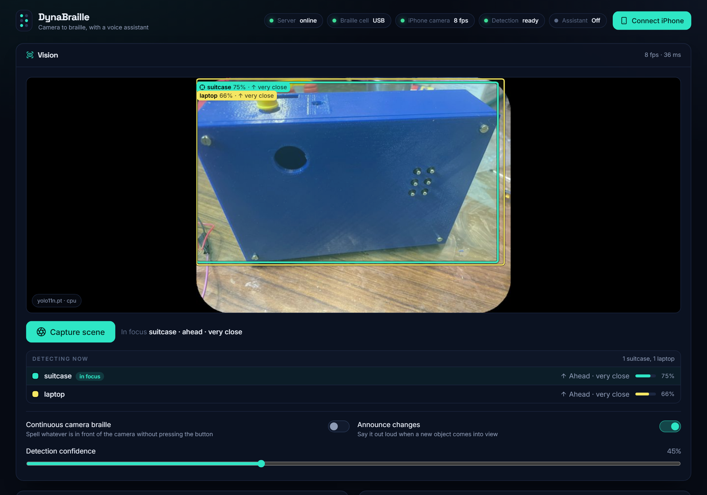
</p>

<table>
  <tr>
    <td width="38%" align="center">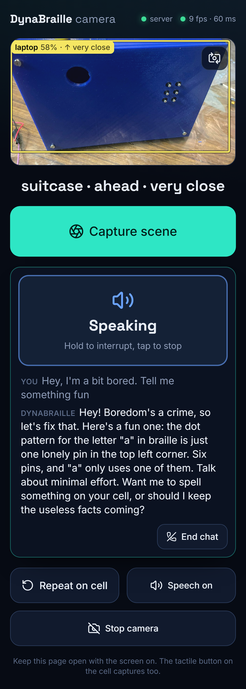</td>
    <td width="62%" align="center">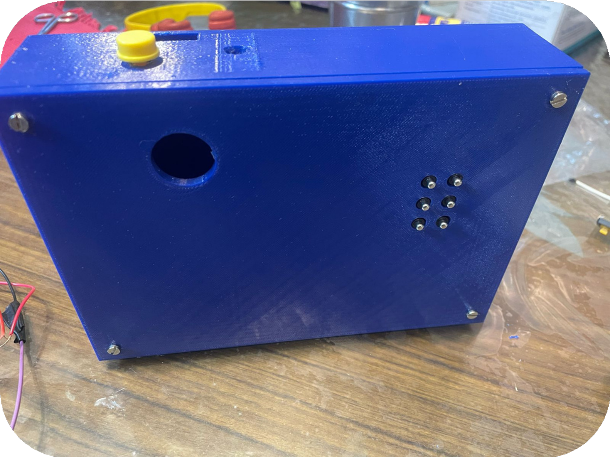</td>
  </tr>
  <tr>
    <td align="center"><sub>The iPhone page: camera, <b>Capture scene</b> and <b>Hold to talk</b></sub></td>
    <td align="center"><sub>The handheld cell: six solenoid pins, a tactile button and an ESP32 inside</sub></td>
  </tr>
</table>

<sub>The screenshots use a photo of the cell as the camera feed. YOLO11 is trained on the 80 COCO
classes, which have no "braille cell", so it calls the box a suitcase and a laptop. The colour
of each box matches its row in <b>Detecting now</b>; the green one is in focus.</sub>

## What it does

| | |
|---|---|
| **Capture button** | Press the tactile button on the cell (or **Capture scene**). The current frame is analysed, the objects are spelled on the cell (`laptop, 2 people`), and the phone says the summary. Double press repeats; hold toggles continuous mode. |
| **Hold to talk** | Hold the phone's big button, speak, let go. The reply comes out of the phone's speaker or your AirPods. Ask what's around you, have it spell a word, or just chat. |
| **Continuous camera braille** | The cell follows whatever is in front of the camera, and new objects are announced. |
| **Dashboard** | Live camera view with labelled boxes, the cell's state, the assistant, and hardware tools (solenoid tester, power budget, self test) on any browser. |

## How it fits together

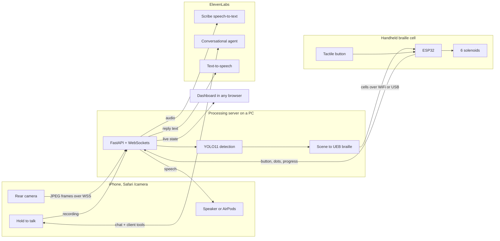

| Part | Folder | What it does |
|---|---|---|
| Processing server | [`server/`](server) | Takes in the iPhone frames, runs YOLO, turns scenes into braille, drives the cell, transcribes hold-to-talk, hands out ElevenLabs credentials. The API key never leaves it |
| Web app | [`web/`](web) | The dashboard (`/`) and the iPhone page (`/camera`), served by the server |
| ESP32 firmware | [`firmware/`](firmware) | WiFi + USB link, timed braille playback, solenoid mapping, peak-and-hold power, safety cut-off, button, self test |
| Pin finder & tester | [`firmware/tools/`](firmware/tools) | Works out which GPIO drives which solenoid, with a clickable board to try each one |
| Docs & charts | [`docs/`](docs) | Hardware, iPhone setup, protocol, and the script that draws the charts below |
| Original desktop app | [`legacy/`](legacy) | The first PyQt prototype, kept for reference |

### Pressing the tactile button

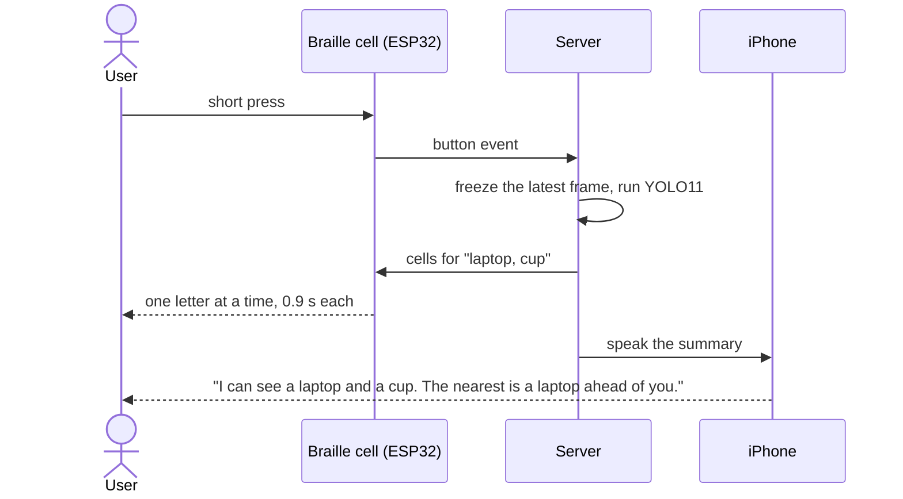

### Hold to talk

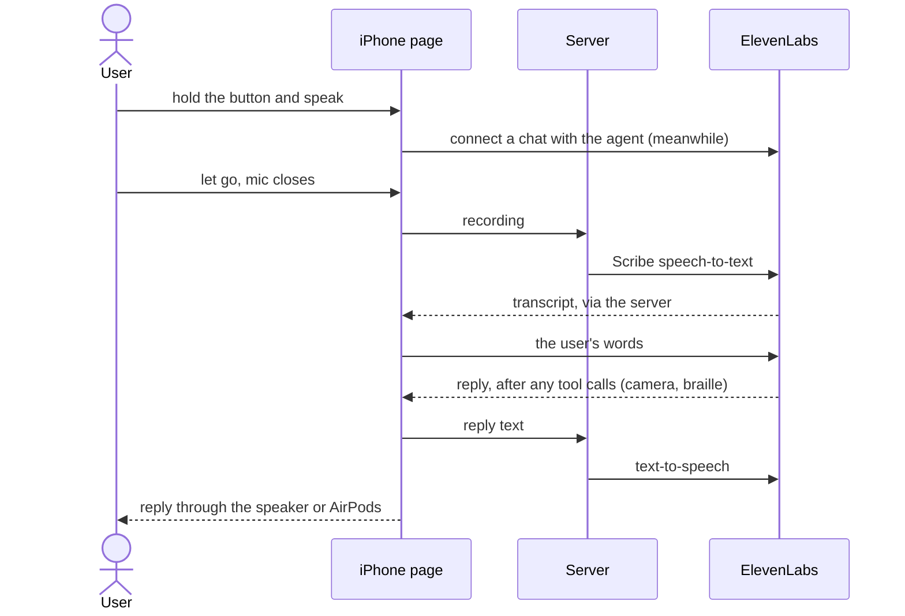

The microphone is only open while the button is held. That also fixes where the sound goes:
while a web page holds the mic, iOS routes audio like a phone call, to the quiet earpiece.
Once it's released, replies play through the loudspeaker or whatever headphones are connected.
You hear a rising tone when the mic opens and a falling one when it closes. Holding again
interrupts the reply.

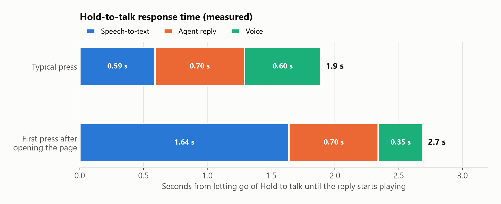

From letting go to hearing the reply takes about two seconds. Object detection (yolo11n on
the PC's CPU) takes about 35 ms per 640-pixel frame, and the phone streams about 8 frames a
second.

## The braille cell

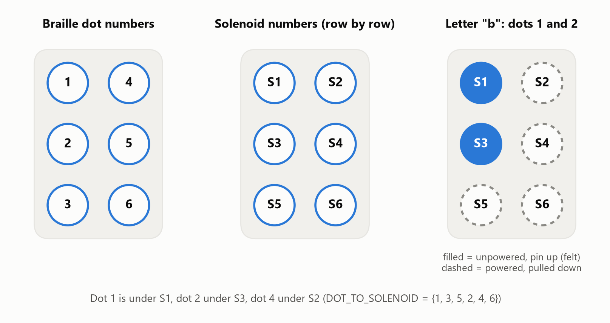

The solenoids are numbered row by row, while braille dots are numbered by column. An
unpowered solenoid sits **up**, so it shows a dot. To show a letter, the firmware powers the
solenoids under the dots that must *not* be felt. Between letters and at rest everything is
off, so all six pins are up. At power-on it steps through S1 to S6 one at a time.

The reference cell's supply can only pull in about three solenoids at once, but most letters
need four or five powered. So firmware 2.3 pulls them in one at a time, then holds them with
20 kHz PWM at half power:

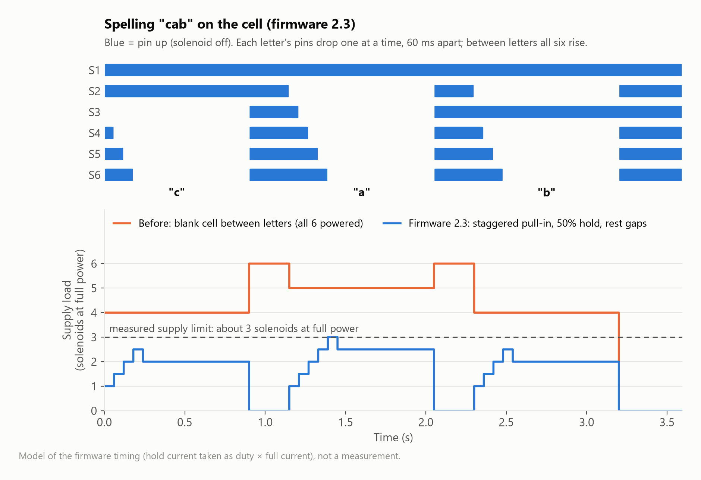

Hold power and pull-in time can be tuned live from the dashboard. Details, wiring and flashing
are in [docs/HARDWARE.md](docs/HARDWARE.md).

## Quick start (Windows)

You need **Python 3.10+** and **Node.js 18+**.

```powershell
powershell -ExecutionPolicy Bypass -File scripts\setup.ps1
```

This creates `server\.venv` (including PyTorch and YOLO, about 1 GB) and `server\.env` with a
random `DEVICE_TOKEN`, then builds the web app.

**Voice assistant.** Create an API key at <https://elevenlabs.io/app/settings/api-keys> with
the Agents, Text to Speech and Speech to Text permissions. It starts with `sk_` and is shown
only once. Put it in `server\.env`, then create the agent and its tools:

```powershell
server\.venv\Scripts\python server\scripts\provision_agent.py
```

**Run it:**

```powershell
powershell -ExecutionPolicy Bypass -File scripts\start.ps1
```

- Dashboard: <http://localhost:8000>
- iPhone: tap **Connect iPhone** on the dashboard and follow the QR codes. Steps are in
  [docs/IPHONE.md](docs/IPHONE.md).
- ESP32: set your WiFi in `firmware\dynabraille_esp32\config.h`, then
  `scripts\flash-firmware.ps1 -Port COM5 -Monitor`. Steps are in [docs/HARDWARE.md](docs/HARDWARE.md).

When Windows asks, allow Python through the firewall on **private** networks, or the phone and
the ESP32 can't reach the server. macOS and Linux have `scripts/setup.sh` and `scripts/start.sh`.

Everything works without the hardware. With no cell connected, braille plays on screen, and
`server\scripts\fake_device.py` pretends to be the ESP32.

## The voice assistant

`provision_agent.py` creates an ElevenLabs agent whose personality is a warm, curious friend:
it talks about anything (music, homework, recipes, jokes, how your day went), remembers what
you said earlier in the conversation, and never says it can "only help with braille". When it
helps, it uses these client tools, which run in the browser and call the server:

| Tool | What the agent uses it for |
|---|---|
| `get_surroundings` | "What's in front of me?": objects with left / ahead / right and rough distance |
| `show_in_braille` | "Spell *exit* on my cell" |
| `stop_braille` | Clear the cell |
| `set_camera_braille` | Pause or resume continuous camera braille |
| `get_device_status` | Battery, signal, light level, connection |

The phone uses hold-to-talk. The dashboard has a tap-to-talk voice orb (WebRTC) and a typing
chat. Both get short-lived credentials from the server (`/api/assistant/session`), so the API
key stays on the PC. Re-run the script any time to push prompt changes.

## Configuration

All settings live in `server/.env` (template: [`server/.env.example`](server/.env.example)).

| Setting | Default | |
|---|---|---|
| `ELEVENLABS_API_KEY` / `ELEVENLABS_AGENT_ID` | — | The agent ID is filled in by `provision_agent.py` |
| `ELEVENLABS_VOICE_ID` | George | Used for the agent and announcements |
| `ELEVENLABS_STT_MODEL` / `ELEVENLABS_STT_LANGUAGE` | `scribe_v2` / `en` | Hold-to-talk transcription; empty language = auto-detect |
| `DEVICE_TOKEN` | random | Must match `DEVICE_TOKEN` in the firmware's `config.h` (the flash script syncs it) |
| `DEVICE_SERIAL_PORT` | off | `auto` or `COM5` to also drive the cell over USB |
| `HTTP_PORT` / `HTTPS_PORT` | 8000 / 8443 | HTTPS is required for the iPhone camera and mic |
| `MDNS_HOSTNAME` | `dynabraille` | The phone can use `https://dynabraille.local:8443/camera` |
| `YOLO_MODEL` | `yolo11n.pt` | `yolo11s.pt` is more accurate but slower |
| `CAMERA_SOURCE` | — | Optional second camera: webcam index or MJPEG/RTSP URL |

Braille speed, detection confidence, continuous mode, announcements and the solenoid power
budget are set on the dashboard and saved to `server/data/preferences.json`.

## Development

```powershell
scripts\dev.ps1                                             # server + Vite hot reload on :5173
server\.venv\Scripts\python -m pytest server\tests          # server tests
server\.venv\Scripts\python server\scripts\fake_device.py   # simulated ESP32 (s/d/l + Enter = button)
server\.venv\Scripts\python docs\make_charts.py             # redraw the charts in docs/images
cd web; npm run typecheck
```

- Message formats and endpoints: [docs/PROTOCOL.md](docs/PROTOCOL.md)
- Interactive REST docs: <http://localhost:8000/docs>

```
server/dynabraille/   app.py (HTTP + WebSockets), controller.py (camera → scene → braille/speech),
                      braille.py (UEB grade 1), scene.py, vision.py (YOLO), devices.py,
                      serial_link.py, elevenlabs.py (agent, TTS, STT), network.py (HTTPS, mDNS), hub.py
web/src/              pages/Dashboard.tsx, pages/CameraPage.tsx, components/HoldToTalk.tsx,
                      components/Assistant.tsx, components/Detections.tsx, lib/speech.ts, …
firmware/             dynabraille_esp32/ (firmware.cpp, config.example.h), tools/pin_finder/
```

## Where it started

<details>
<summary>The original concept: a camera wearable, a guardian website and the handheld cell</summary>

The first design paired a camera on a pair of glasses (Raspberry Pi Zero 2 W, earphones, a
light sensor and light aid) with the handheld cell and a processing server. The current build
uses an iPhone as the camera, microphone and speaker instead.

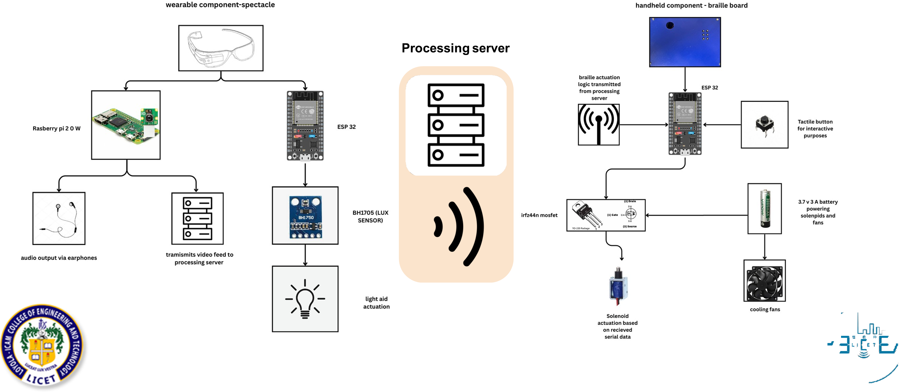

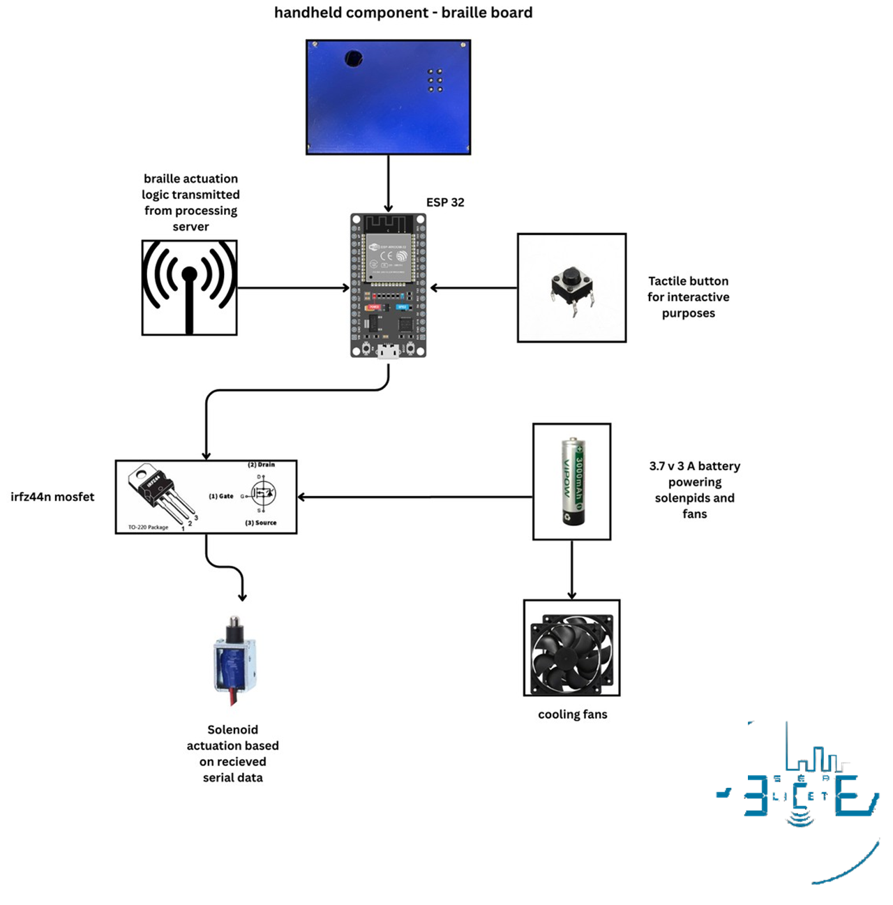

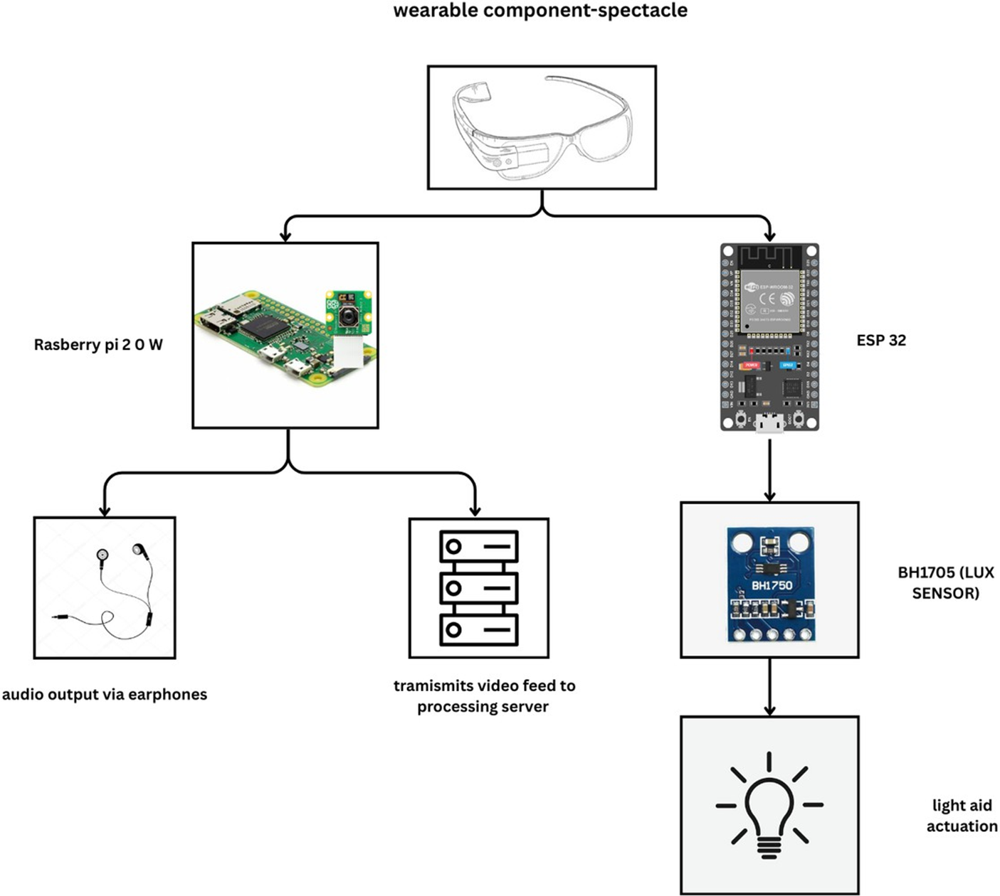

A guardian website was planned so family members could keep in touch about the user's
whereabouts and safety:

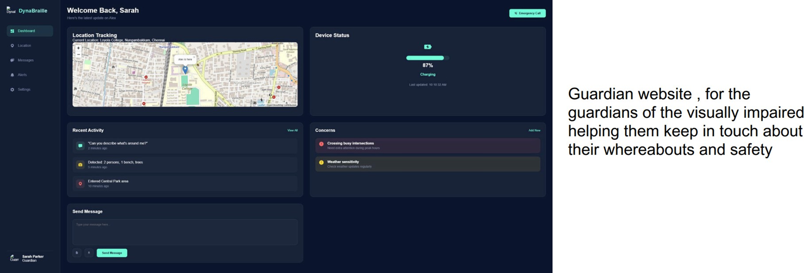

The first desktop test interface (now in [`legacy/`](legacy)) and the cell's electronics
before they went into the case:

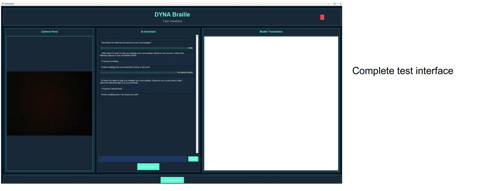

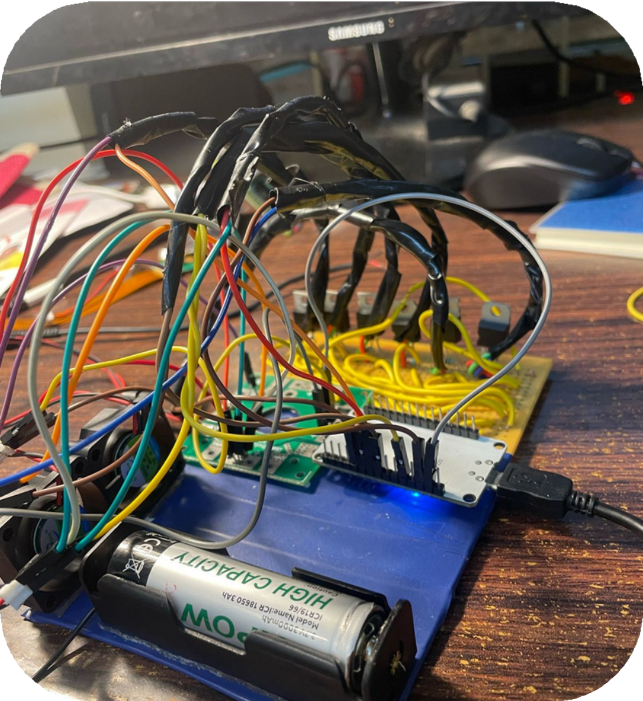

</details>

## Safety

Object detection recognises common objects only, and its distances are rough. Dyna Braille
adds awareness; it does not replace a cane, a guide dog or a sighted guide, and it must never
be used to judge whether a road is safe to cross. The assistant is told the same and points
people to emergency services when something is wrong.

## License

MIT, see [LICENSE](LICENSE).
