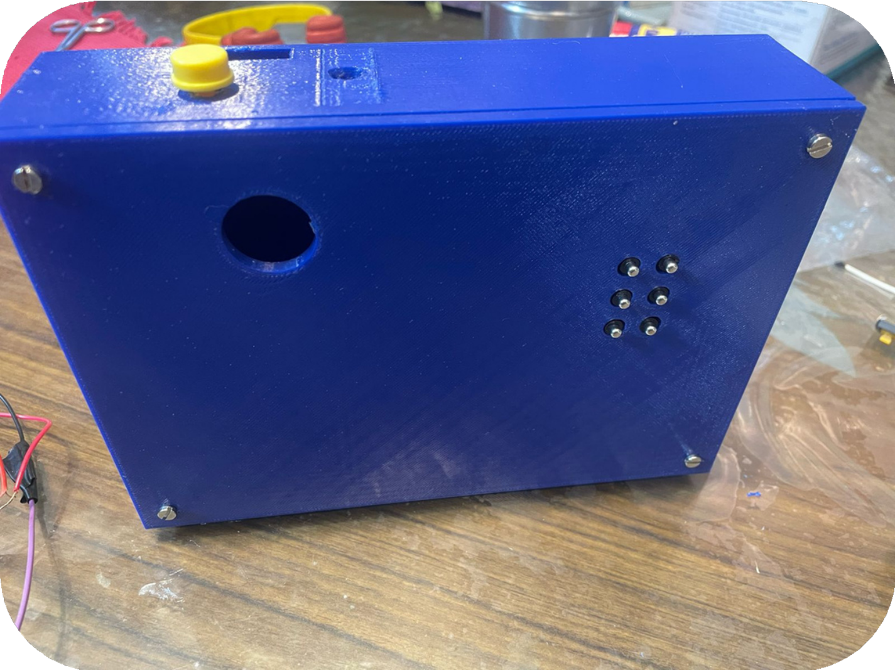
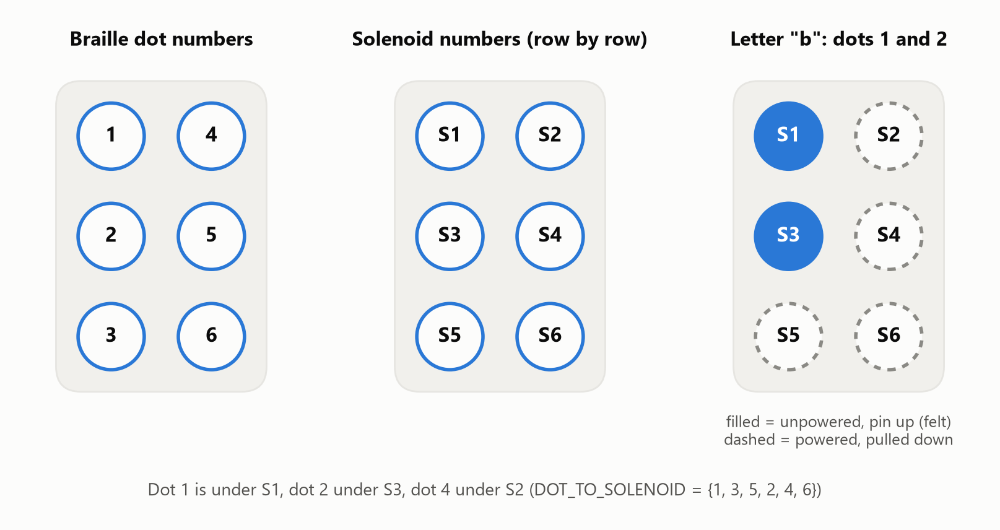
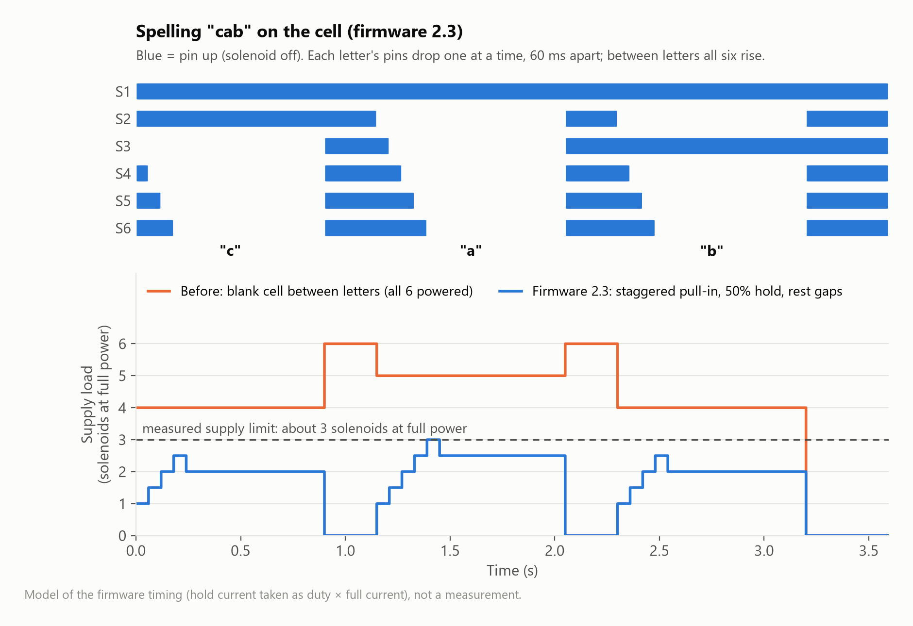

# Hardware: the handheld braille cell



## Parts

- **ESP32 DevKit V1** (ESP32-WROOM-32, 30 pins, USB-C). Its USB chip is a CH9102 or CP2102;
  Windows 11 usually installs the driver by itself, and the board shows up as a COM port.
- 6 × 5 V push-pull solenoids
- 6 × N-channel MOSFETs, one per solenoid, each with a flyback diode
- Tactile push button
- 5 V supply for the solenoids. The reference cell's supply pulls in about **3 solenoids at
  full power**, which the firmware works around (see [Power budget](#power-budget)); a supply
  rated 3 A or more gives headroom. Or the 3.7 V battery pack with a boost converter
- Optional: BH1750 light sensor, an LED "light aid", and a voltage divider for battery level

## The cell

```
 Solenoid numbers         Braille dot numbers
 (your wiring)            (what the software uses)
   S1   S2                   1   4
   S3   S4                   2   5
   S5   S6                   3   6
```



| Braille dot | 1 | 2 | 3 | 4 | 5 | 6 |
|---|---|---|---|---|---|---|
| Solenoid | S1 | S3 | S5 | S2 | S4 | S6 |

That table is `DOT_TO_SOLENOID {1, 3, 5, 2, 4, 6}` in `config.h`. The server always uses
braille numbers, and the firmware maps them onto the solenoids.

### Polarity: unpowered = pin up = dot

On this build a solenoid that is **off sits up** and you feel it as a dot. Powering it pulls
the pin **down**. So the firmware (with `SOLENOID_ON_RAISES_DOT 0`):

- **Letter:** powers the solenoids under the dots that should *not* be felt.
  "b" (dots 1-2) powers S2, S4, S5, S6, which leaves S1 and S3 up.
- **Gap between letters** (`gap_ms`, default 250 ms): everything off, so all six pins pop up
  for a moment and double letters like "ll" read as two letters. This costs no power.
  (`GAP_IS_BLANK 1` shows a blank cell instead, but on this build that means powering all six.)
- **Rest** (after a word, at boot, on Stop): everything off, so all six pins are up. The
  dashboard draws this muted as "Resting".
- **Safety:** any solenoid that stays powered for longer than `MAX_ON_MS` (20 s) makes the
  firmware switch everything off and report an error. A single character sent on its own is
  held for `STATIC_HOLD_MS` (8 s), then the cell rests.

If you rebuild the cell so that powered = up, set `SOLENOID_ON_RAISES_DOT 1`. Nothing else
changes.

### Power budget

A solenoid needs full current to pull its plunger in, but much less to keep it there. The
reference cell's supply can only pull in about three at once, while most letters need four or
five powered (only the dots stay up). Firmware 2.3 therefore:

1. **Pulls in one solenoid at a time** (`PULL_IN_AT_ONCE 1`), each at full power for
   `PULL_IN_MS` (60 ms).
2. **Holds them with PWM** at `HOLD_DUTY_PERCENT` (50%) at 20 kHz, above hearing.
3. **Rests between letters** instead of showing a blank cell, which used to power all six.



Both numbers can be tuned live on the dashboard (**Hardware → Actuate solenoids → Hold power /
Pull-in at full power**). The server stores them and sends them to the cell whenever it
connects. Press **All on**: if all six stay down, lower Hold power until one rises and set it
10–15% above that. If even 100% can't hold more than three, the supply or the MOSFETs are the
limit (see the IRFZ44N note below).

### Power-on self test

At boot the firmware switches S1, S2, … S6 on and off one at a time (400 ms on, 250 ms off),
so you can see that every solenoid and its wiring works. The dashboard's **Power-on test**
button runs it again. Turn it off with `BOOT_SELF_TEST 0`.

## Wiring

```
ESP32 GPIO ──220 Ω── MOSFET gate          5 V (+) ──┬── solenoid (+)
                     │                              │
                    10 kΩ to GND              flyback diode (cathode to +5 V)
                                                    │
                     MOSFET drain ──────────────────┴── solenoid (−)
                     MOSFET source ── GND (shared with the ESP32 GND)
```

- **Common ground:** the solenoid supply's GND must connect to the ESP32's GND.
- **Flyback diodes** (1N4007 or 1N5819) across every solenoid protect the MOSFETs.
- **IRFZ44N vs IRLZ44N:** the IRFZ44N isn't a logic-level part. At the ESP32's 3.3 V it may only
  half switch on, which makes the solenoids weak and the MOSFET hot. The IRLZ44N, or a small
  gate driver, switches fully.
- **GPIO 12** is a boot-strapping pin. With a gate pull-down it's fine; if the board ever
  refuses to boot with the cell connected, move that solenoid to GPIO 13.
- **Button:** between the button GPIO and GND. The internal pull-up is used.

Reference cell pins (S1…S6): `15, 21, 4, 5, 18, 19`, found with the pin finder. Button: `32`
(not confirmed yet on the reference cell). Status LED: `2`, the on-board blue LED. The optional
BH1750 uses I2C on `22`/`23`, because GPIO21 drives S2.

### Don't know which GPIO goes where?

When the wiring is under the board, flash the **pin finder** first
([firmware/tools/pin_finder](../firmware/tools/pin_finder/README.md)):

```powershell
powershell -ExecutionPolicy Bypass -File scripts\flash-firmware.ps1 -PinFinder -Port COM5 -Monitor
```

Type `s`, then for each pulsing GPIO type the solenoid that moves (1–6), or 0 if nothing moves.
Type `b` to find the button. It prints the `SOLENOID_PINS` and `BUTTON_PIN` lines to paste
into `config.h`.

## Configure and flash the firmware

1. Edit `firmware/dynabraille_esp32/config.h`. It's created from `config.example.h` and
   git-ignored. Set:
   - `WIFI_SSID_1` / `WIFI_PASS_1`. 2.4 GHz only. An iPhone hotspot works with
     *Maximise Compatibility* on.
   - `SOLENOID_PINS` and `BUTTON_PIN`, from the pin finder.
   - `DEVICE_TOKEN` is copied from `server/.env` by the flash script.
   - Leave `SERVER_HOST` empty: the cell finds the server over mDNS. Set an IP only if your
     network blocks multicast.
2. Flash. Pick one:
   - **Script (PlatformIO, installed locally the first time):**
     ```powershell
     powershell -ExecutionPolicy Bypass -File scripts\flash-firmware.ps1 -Port COM5 -Monitor
     ```
   - **Arduino IDE 2:** add the ESP32 boards URL
     `https://espressif.github.io/arduino-esp32/package_esp32_index.json`, install
     **esp32 by Espressif Systems**, and install the libraries **ArduinoJson** (v7) and
     **WebSockets** by Markus Sattler. Open `firmware/dynabraille_esp32/dynabraille_esp32.ino`,
     choose board **ESP32 Dev Module** and Partition Scheme **Minimal SPIFFS (1.9MB APP with
     OTA)**, select the port, then Upload.
   - If the upload stops at `Connecting....`, hold the board's **BOOT** button until it starts.

## First boot: what you should see

Serial monitor at 115200 baud:

```
# DynaBraille firmware 2.3.0  id=dynabraille-a1b2c3
# self test: solenoid S1 (GPIO 15)
...
# wifi up: MyWiFi  ip=192.168.1.42  rssi=-58
# found server via mDNS: 192.168.1.3:8000
# server connected: 192.168.1.3:8000
```

The status LED blinks fast while joining WiFi, slowly while it looks for the server, and stays
solid once connected. The dashboard then shows the cell under **Hardware**.

## Testing over USB without WiFi

The firmware also accepts commands as JSON lines over serial. In any serial monitor
(115200 baud, newline line ending):

```json
{"type":"show","id":1,"cells":[1,3,9],"char_ms":900,"gap_ms":250}
{"type":"cell","dots":[1,2,5]}
{"type":"test","solenoid":2}
{"type":"selftest"}
{"type":"stop"}
```

The first line shows "a", "b", "c". The original v1 commands (`{"type":"braille","dots":[1,2]}`)
still work. To let the server drive the cell over USB, set `DEVICE_SERIAL_PORT=COM5` in
`server/.env`, and close the serial monitor first.

## Troubleshooting

| Symptom | Check |
|---|---|
| Nothing moves during the self test | Solenoid supply on? Common GND? A MOSFET gate measures 3.3 V when on? |
| The wrong pin moves | Run the pin finder and fix `SOLENOID_PINS` |
| Letters come out mirrored or shuffled | `DOT_TO_SOLENOID` doesn't match how the solenoids are numbered |
| Every dot is inverted | Flip `SOLENOID_ON_RAISES_DOT` |
| Solenoids weak or MOSFETs hot | IRFZ44N at 3.3 V: use IRLZ44N or a gate driver |
| Only some pins stay down when several are powered | Supply limit: raise Hold power or Pull-in on the dashboard, or use a bigger 5 V supply. See [Power budget](#power-budget) |
| Fast blink forever | Wrong WiFi details, or a 5 GHz-only network |
| Slow blink forever | Server not found: is it running? Is the firewall open? Set `SERVER_HOST` to the PC's IP |
| Server log says "rejected device ... bad token" | `DEVICE_TOKEN` in config.h ≠ server/.env. Re-flash with the script |
| Board won't boot with the cell attached | A strapping pin (GPIO 12) pulled high: add a gate pull-down or move that solenoid |
| "solenoid Sx was on too long" | A very long word or `MAX_ON_MS` too low. Shorten the text, or raise `MAX_ON_MS` carefully |

## Safety

- Solenoids held on get hot. The firmware limits on-time, but don't leave the cell
  showing one static character for long.
- Use wire rated for the solenoid current, and insulate every connection.
- Don't exceed the solenoids' rated voltage.
